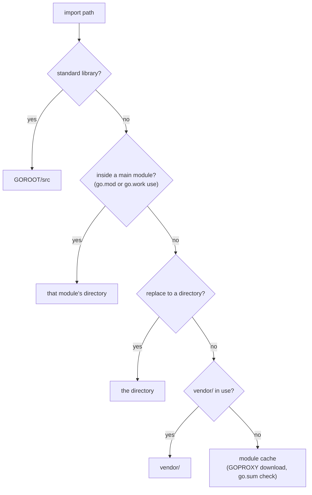

# Modules and packages

Every chapter so far has quietly lived inside a module: the `go.mod` at the root
of this repo. This chapter makes that machinery visible. A **package** is a
directory of `.go` files compiled together; a **module** is a tree of packages
versioned and released as one unit, described by the `go.mod` at its root.

The exercises run offline (`GOPROXY=off`), so every dependency here is a local
directory. The parts of the module system that need a network — downloading,
checksums, version selection across a registry — are covered in prose at the
end.

## 1. `go.mod` names the module

```go
module example.com/hello     // the module path

go 1.26.0                    // the language version (section 6)
```

`go mod init example.com/hello` writes this file. The **module path** is both
the module's name and the import prefix of every package inside it. Without the
`module` line the toolchain cannot place anything (`modules1`):

```
go: error reading go.mod: missing module declaration
```

The path does not have to resolve to a real server until someone tries to
download it. For a module you will publish, use the repository URL
(`github.com/you/project`); for one you never will, any domain-shaped name
works, and `example.com` is reserved for exactly that.

## 2. Import path = module path + directory

```ascii
module example.com/shop          go.mod
         │
         ├── shop.go             import "example.com/shop"
         └── cart/cart.go        import "example.com/shop/cart"
                                         └─ module ─┘└ dir ┘
```

`modules2`. A package's import path is never just its directory name — `import
"cart"` makes the toolchain look in the standard library, find nothing, and
fail with `package cart is not in std`. Only the standard library has short
paths.

The **package name** (the `package` clause) is separate from the path. By
convention it matches the last path element, and it is what you type at the
call site: `cart.Total`. One directory holds exactly one package, plus an
optional external `_test` package (next section).

## 3. Exported means capitalised

```go
type Reading struct {
    Celsius float64     // visible to importers
    raw     []byte      // visible only inside package temp
}

func Fahrenheit(r Reading) float64 { … }   // exported
func round(x float64) float64 { … }        // not
```

`modules3`. Go has no `public`/`private` keywords: an identifier starting with
an upper-case letter is **exported** from its package, everything else is not.
The rule applies to types, functions, constants, variables, struct fields, and
methods alike — and it is per **package**, not per file or per module.

Tests in `package temp_test` (an **external test package**, same directory,
`_test` suffix) import `temp` like any other client and see only its exported
API. Tests in `package temp` see everything. Use the external form when you want
the test to prove the API is usable from outside.

## 4. `internal/` restricts who may import

```ascii
example.com/bank
├── report.go                    ✗ cannot import ledger/internal/money
└── ledger/
    ├── ledger.go                ✓ may import ledger/internal/money
    └── internal/money/
```

`modules4`. A package whose path contains an `internal` element can be imported
only by code rooted at the **parent** of that `internal` directory. Exported
names inside it are exported to that subtree and nowhere else; the compiler
enforces it:

```
use of internal package example.com/bank/ledger/internal/money not allowed
```

This is how a module keeps helpers out of its public API: code under
`internal/` can change freely because no other module can depend on it. The fix
for a blocked import is almost always to go through the public package that owns
the internal one.

## 5. `require` and `replace`

```go
module example.com/app

go 1.26.0

require example.com/mathx v0.0.0

replace example.com/mathx => ./mathx
```

`modules5`. `require` says which modules this one depends on, and at what
minimum version. `replace` says where to get a module instead of the usual
download — here, a sibling directory that has its own `go.mod`. With a directory
replacement the version on the `require` line is a placeholder; it must be
syntactically valid but nothing is fetched.

`replace` takes effect **only in the main module** (the one you are building).
A `replace` in a dependency's `go.mod` is ignored, so it is a development tool,
not something you can ship to your users.

## 6. Major versions live in the import path

```go
require example.com/units/v2 v2.0.0

import "example.com/units/v2"     // the path ends in /v2 …
units.CToF(20)                    // … the package is still called units
```

`modules6`. Go's **import compatibility rule**: if an old and a new package have
the same import path, the new one must be backwards compatible with the old.
So a breaking change (v2, v3, …) gets a **new path** with a `/vN` suffix, and
the module's own `go.mod` declares `module example.com/units/v2`. `v0` and `v1`
have no suffix.

Consequences worth knowing: `v1` and `v2` of the same module are different
modules and can be imported side by side in one build; and forgetting the
suffix gives `no required module provides package example.com/units`, because
`example.com/units` (v1) was never required.

## 7. The `go` line is the language version

```go
go 1.21     // for i := range n  →  requires go1.22 or later
```

`modules7`. The `go` directive is not a comment about which toolchain you
happen to have. It sets the **language version** the module's code is compiled
as, and since Go 1.21 it is also a minimum: an older toolchain refuses to build
the module. Language changes are gated on it — a module declaring `go 1.21`
cannot range over an integer and keeps the pre-1.22 shared loop variable, even
when compiled by Go 1.26.

Each module in a build is compiled at its own `go` version, which is how old
dependencies keep working when the language changes.

## 8. `init` and the blank import

```go
// package email
func init() {
    sender.Register("email", send)
}

// package notify
import _ "example.com/notify/sender/email"   // link it in, run its init
```

`modules8`. Every package may define `init()` functions. They take no arguments,
cannot be called, and run once, automatically, after the package's variables are
initialised and after every package it imports has finished its own init. The
order is fixed by the import graph, so `init` can rely on its dependencies being
ready.

But `init` runs only if the package is **in the program**, and a package is in
the program only if something imports it. Go refuses unused imports, so the
**blank import** `_` exists to import a package purely for its side effects.
This is the `database/sql` driver pattern:

```go
import (
    "database/sql"
    _ "github.com/lib/pq"     // registers the "postgres" driver
)

db, err := sql.Open("postgres", dsn)
```

Keep `init` small and side-effect-light: it runs before `main`, cannot return
an error, and runs in tests too.

## 9. Workspaces: `go.work`

```go
go 1.26.0

use (
    ./app
    ./greet
)
```

`modules9`. A **workspace** lets you develop several modules together. Every
module listed in `use` is a main module, and imports between them resolve to
the local directories — no `replace` lines, no edits to any `go.mod`. `go work
init` creates the file and `go work use ./dir` adds to it.

The difference from `replace`: `go.work` lives outside the modules, so each
`go.mod` stays exactly as it will be published. A `go.work` describes one
developer's checkout and is usually left uncommitted. The toolchain finds it by
walking up from the current directory; `GOWORK=off` ignores it.

## 10. `go mod tidy` and `// indirect`

```go
require example.com/table v0.0.0

require example.com/pad v0.0.0 // indirect
```

`modules10`. `go mod tidy` rewrites `go.mod` (and `go.sum`) to match the
imports actually in your code: it adds what is missing, removes requirements
nothing imports, and marks with `// indirect` the modules you need only because
a dependency needs them. Since Go 1.17 the main module's `go.mod` lists every
module that provides a package in the build, indirect ones included, so the
toolchain can load the module graph without reading every dependency's
`go.mod`. A missing one stops the build:

```
go: updates to go.mod needed; to update it:
	go mod tidy
```

`go mod tidy -diff` (Go 1.23) prints the changes tidy would make and exits
non-zero if there are any, without writing — the form to put in CI.

## 11. Vendoring

```
go mod vendor      # copy every needed package into ./vendor
```

`modules11`. `vendor/` holds a copy of each dependency's packages, plus
`vendor/modules.txt` recording which module versions they came from. When a
`vendor/` directory exists and the `go` line is 1.14 or later, builds read from
it by default (`-mod=vendor`) and never touch the module cache or network.

`go.mod` and `modules.txt` must agree. Change a requirement without re-running
`go mod vendor` and every build stops:

```
go: inconsistent vendoring in …:
	example.com/slug@v0.0.0: is explicitly required in go.mod, but not marked as explicit in vendor/modules.txt
```

Vendoring trades repository size for builds that need nothing but the source
tree. Most projects rely on the module proxy and `go.sum` instead.

## How the toolchain finds a package



Every exercise in this chapter stays in the top four boxes. The last one is the
subject of the next section.

## Not exercised here: the network side

These need a module proxy, the checksum database, or published versions, and
the exercises run with `GOPROXY=off`. They are what you meet the first time a
project depends on someone else's code.

- **`go get example.com/mod@v1.4.2`** — adds or changes a requirement in
  `go.mod`. `@latest` picks the newest release; `@none` removes the dependency.
  Since Go 1.17 `go get` only manages `go.mod`; installing a binary is `go
  install example.com/cmd@version`.
- **`go.sum` and the checksum database** — `go.sum` records a cryptographic
  hash of every module version (and its `go.mod`) the build uses, and the
  toolchain verifies each download against it. The first time a version is
  seen, its hash is checked against `sum.golang.org` (`GOSUMDB`), a public,
  append-only log, so a proxy or origin server cannot hand you different code
  than everyone else got. Commit `go.sum`. Directory replacements are not
  hashed, which is why no exercise here has one.
- **Minimal version selection (MVS)** — each `require` is a *minimum*. The
  build uses, for each module, the highest minimum anyone in the graph asks for
  — never something newer just because it exists. The result is reproducible
  from `go.mod` alone, with no separate lock file, and upgrades happen only
  when you ask (`go get -u`).
- **`GOPROXY`, `GOPRIVATE`, `GONOSUMDB`** — `GOPROXY` lists where modules are
  downloaded from (default `https://proxy.golang.org,direct`; `off` forbids
  downloads, as here). `GOPRIVATE` is a glob list of module paths, such as
  `github.com/yourcorp/*`, that skip both the public proxy and the checksum
  database, so private code is fetched directly and its paths never leak.
  `GONOPROXY` and `GONOSUMDB` set each half separately.
- **`toolchain` and `GOTOOLCHAIN`** — since Go 1.21 a `go.mod` can say
  `toolchain go1.26.4` to recommend a specific release. With the default
  `GOTOOLCHAIN=auto`, a `go` command older than the module's `go` or
  `toolchain` line downloads the newer toolchain and re-runs itself.
  `GOTOOLCHAIN=local` forbids that and fails instead.
- **`retract`** — a module author withdraws a bad version by publishing a newer
  one whose `go.mod` says `retract v1.2.0 // data race in Parse`. `go get`
  then skips retracted versions when resolving `@latest`, and `go list -m -u`
  warns users who already depend on one. It never deletes anything: published
  versions are immutable.

## Gotchas

- **`import "cart"` is a standard-library lookup.** Non-std imports always
  start with a module path.
- **Lowercase is unexported everywhere**, including struct fields — which is
  also why `encoding/json` cannot see them.
- **`internal/` is about the import path, not the module.** Even another
  package in the same module is blocked if it sits outside internal's parent.
- **`replace` in a dependency does nothing.** Only the main module's `replace`
  lines count.
- **`/v2` goes in the import path, not the package name.** You still call
  `units.CToF`.
- **The `go` line changes semantics**, not just which features compile — loop
  variable scoping among them.
- **An unused import is an error; a blank import is not.** A side-effect
  package imported without `_` fails to compile.
- **Don't hand-edit `go.mod` into shape.** `go mod tidy` knows the full import
  graph; you do not.
- **Re-run `go mod vendor` after every `go.mod` change** in a vendored module.

## The exercises

- **modules1** — give a `go.mod` the module path its tests import.
- **modules2** — import a package in the same module by its full path.
- **modules3** — export what the external test package needs.
- **modules4** — reach an `internal` package through the API that owns it.
- **modules5** — require a sibling module and point the build at its
  directory.
- **modules6** — import a v2 module by its major-version path.
- **modules7** — raise the `go` line to the version the code is written in.
- **modules8** — pull in a package for its `init` alone.
- **modules9** — add a local module to a workspace.
- **modules10** — let the toolchain bring a drifted `go.mod` back in line.
- **modules11** — resync `vendor/` with `go.mod`.

## Source references

- [Go Modules Reference](https://go.dev/ref/mod) — the full specification;
  see [major version suffixes](https://go.dev/ref/mod#major-version-suffixes),
  [`replace`](https://go.dev/ref/mod#go-mod-file-replace),
  [`go`](https://go.dev/ref/mod#go-mod-file-go),
  [workspaces](https://go.dev/ref/mod#workspaces),
  [`go mod tidy`](https://go.dev/ref/mod#go-mod-tidy),
  [vendoring](https://go.dev/ref/mod#vendoring)
- Network side: [MVS](https://go.dev/ref/mod#minimal-version-selection) ·
  [checksum database](https://go.dev/ref/mod#checksum-database) ·
  [private modules](https://go.dev/ref/mod#private-modules) ·
  [`retract`](https://go.dev/ref/mod#go-mod-file-retract) ·
  [`toolchain`](https://go.dev/ref/mod#go-mod-file-toolchain) ·
  [Go Toolchains](https://go.dev/doc/toolchain)
- [go.mod file reference](https://go.dev/doc/modules/gomod-ref) ·
  [Managing dependencies](https://go.dev/doc/modules/managing-dependencies) ·
  [Organizing a Go module](https://go.dev/doc/modules/layout)
- [Tutorial: Create a Go module](https://go.dev/doc/tutorial/create-module) ·
  [Tutorial: multi-module workspaces](https://go.dev/doc/tutorial/workspaces)
- [Go blog: Using Go Modules](https://go.dev/blog/using-go-modules) ·
  [Go Modules: v2 and Beyond](https://go.dev/blog/v2-go-modules) ·
  [Module Mirror and Checksum Database Launched](https://go.dev/blog/module-mirror-launch)
- [`go` command: internal packages](https://pkg.go.dev/cmd/go#hdr-Internal_packages) ·
  [Spec: exported identifiers](https://go.dev/ref/spec#Exported_identifiers) ·
  [package initialization](https://go.dev/ref/spec#Package_initialization)
- [Effective Go: the init function](https://go.dev/doc/effective_go#init) ·
  [pkg.go.dev: database/sql](https://pkg.go.dev/database/sql)

**Next: [dependency_injection](../dependency_injection/) →** — with packages in
place, how to pass one package's behaviour into another so it can be tested.
